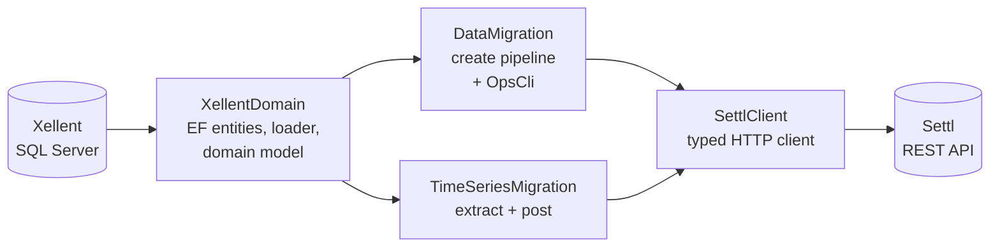

# rewire

Tools for moving a Danish utility's customers, metering points and time series from **Xellent** (a utility billing system built on Microsoft Dynamics AX 2009) to **Settl** (a cloud billing platform with a REST API).

One .NET 9 solution covers the whole path: reading Xellent's SQL database, turning it into a source-agnostic domain model, creating the matching entities in Settl, moving the metering point time series, and checking afterwards that both sides agree.



## Contents

- [Repository layout](#repository-layout)
- [Getting started](#getting-started)
- [Configuration](#configuration)
- [Running the tools](#running-the-tools)
- [Safety model](#safety-model)
- [Domain concepts](#domain-concepts)
- [Tests](#tests)
- [Documentation](#documentation)

## Repository layout

The solution is four folders that used to be separate repositories. They reference each other with `ProjectReference`, so a change in one folder reaches the others at the next build. Nothing is published as a NuGet package from here.

| Folder | What it holds | Main projects |
|--------|---------------|---------------|
| [`XellentDomain/`](XellentDomain/) | Xellent database access and the domain model every tool shares | `DataMigration.XellentData` (EF Core entities), `DataMigration.Domain` (Customer, Contract, MeteringPoint, …), `DataMigration.Domain.Xellent` (Xellent → domain loader, representative resolver, validators), `DataMigration.Core` |
| [`SettlClient/`](SettlClient/) | The Settl API client | `DataMigration.SettlApi` (typed clients and contracts), `DataMigration.SettlClient` (domain → Settl orchestrator and translators) |
| [`DataMigration/`](DataMigration/) | Customer master data migration and operations | `DataMigration.Migration` (MigrationCli, `create`), `DataMigration.OpsCli` (reports, reconciliation, state generation, repairs) |
| [`TimeSeriesMigration/`](TimeSeriesMigration/) | Metering point time series | `TimeSeries.Cli`, `TimeSeries.Migration` (runner, extraction, snapshot store), `TimeSeries.Core` |

Each folder has its own `README.md`, `CLAUDE.md` and `docs/`. Read the folder's guide before changing it.

## Getting started

You need the [.NET 9 SDK](https://dotnet.microsoft.com/download/dotnet/9.0). Building and testing need nothing else: no database, no network access to Xellent or Settl, and no secrets.

```bash
git clone https://github.com/kloppnr1/rewire
cd rewire
dotnet build rewire.slnx
dotnet test rewire.slnx
```

Check that the CLIs start:

```bash
dotnet run --project DataMigration/src/DataMigration.Migration -- --help
dotnet run --project DataMigration/src/DataMigration.OpsCli -- --help
dotnet run --project TimeSeriesMigration/src/TimeSeries.Cli -- post --help --env featuretest
```

`TimeSeries.Cli` loads its configuration before it parses `--help`, so it needs `--env` even for help.

## Configuration

`appsettings.json` in each CLI has the full structure, but its host names are placeholders and every credential is empty:

| Placeholder | Stands for |
|-------------|-----------|
| `settl-featuretest.example.invalid`, `settl-production.example.invalid`, `settl-production-hev.example.invalid`, `settl-production-vhel.example.invalid` | The Settl API gateway of each environment |
| `XELLENT-SQL` | The Xellent SQL Server |
| `APP-SERVER`, `STAGING-SERVER` | The servers the tools are deployed to |

To run against real systems, create `appsettings.local.json` next to `appsettings.json` in `DataMigration.Migration`, `DataMigration.OpsCli` and `TimeSeries.Cli`. It is read after `appsettings.json`, overrides it key by key, and is git-ignored. Only the keys you set are replaced:

```json
{
  "ConnectionStrings": {
    "XellentDatabase": "Server=<xellent-server>;Database=AXDB50;Integrated Security=True;TrustServerCertificate=True;"
  },
  "SettlApi": {
    "Environments": {
      "featuretest": {
        "BaseUrl": "https://<featuretest-gateway>",
        "XellentDatabase": "Server=<xellent-server>;Database=AXDB50_TEST;Integrated Security=True;TrustServerCertificate=True;",
        "SubscriptionKey": "<key>",
        "Credentials": { "ClientId": "<id>", "ClientSecret": "<secret>", "Username": "<user>", "Password": "<password>" }
      }
    }
  }
}
```

Never commit real host names or credentials. Production credentials belong only on the server that runs production; see [docs/production-runbook.md](docs/production-runbook.md).

### Environments

| `--env` | Settl | Xellent database |
|---------|-------|------------------|
| `featuretest` | Feature test | `AXDB50_TEST` |
| `production` | Production | `AXDB50` |
| `production-hev` | Production, HEV | `AXDB50` |
| `production-vhel` | Production, VHEL | `AXDB50` |

Always pass `--env`. Without it, `TimeSeries.Cli` falls back to `DOTNET_ENVIRONMENT` before `featuretest`. There is no `staging` environment.

## Running the tools

### MigrationCli: customer master data

`create` migrates the accounts in a profile (`DataMigration/src/profiles/*.json`). For each customer it creates or finds, in order: the customer, the payer, the metering points, the billing configuration, and the links between them. It is safe to run again: whatever already exists in Settl is found and reused.

```bash
# Read Xellent and report what would be created, without calling Settl at all
dotnet run --project DataMigration/src/DataMigration.Migration -- create <profile> --env featuretest --offline

# Read Xellent and Settl, report what would change, write nothing
dotnet run --project DataMigration/src/DataMigration.Migration -- create <profile> --env featuretest --dry-run

# Write to feature test
dotnet run --project DataMigration/src/DataMigration.Migration -- create <profile> --env featuretest
```

`create` is the only component that creates customers in Settl. Drift found later is fixed by running `create` again.

### OpsCli: reports, reconciliation and state

Mostly read-only. The main groups:

| Group | Commands |
|-------|----------|
| Reports | `report`, `report-meteringpoints`, `report-payers`, `report-meter-info`, `report-delivery-start`, `report-contract-impact`, `report-consumer2-duplicate`, `check-customers-in-settl`, `check-share-delivery`, `show-settlement-basis` |
| Comparison and reconciliation | `compare`, `compare-state`, `reconcile`, `reconcile-customer`, `reconcile-apply` |
| Invoice and migration state | `pull-state-sources`, `generate-state-from-settl`, `generate-state`, `build-migration-model` |
| Payments | `payment-match`, `payment-match-mp` |
| Exports and repairs | `export-active-customers`, `prepare-customer-payer-repair`, `prepare-aborabat-repair`, `apply-aborabat-repair` |
| Development | `extract-domain`, `generate-seed` |

Some commands write. Check each command's write behaviour in [DataMigration/src/DataMigration.OpsCli/README.md](DataMigration/src/DataMigration.OpsCli/README.md) before running it; do not infer it from the name.

### TimeSeries.Cli: time series

Reads metering point time series from Xellent, posts them to Settl and registers an externally invoiced period per metering point. Every metering point ends as done, skipped or excluded.

```bash
# Once: keep what the runs need from Settl and Xellent on disk
dotnet run --project TimeSeriesMigration/src/TimeSeries.Cli -- snapshot --env featuretest

# Check where every metering point stands; nothing is sent
dotnet run --project TimeSeriesMigration/src/TimeSeries.Cli -- post --all --env featuretest --offline --dry-run --force

# Send the ready ones
dotnet run --project TimeSeriesMigration/src/TimeSeries.Cli -- post --all --env featuretest --offline --force

# Progress of the last or running run
dotnet run --project TimeSeriesMigration/src/TimeSeries.Cli -- progress --env featuretest
```

The full workflow, states and reports are in [TimeSeriesMigration/README.md](TimeSeriesMigration/README.md). `--offline` only changes where reads come from; posts still go to Settl. Only `--dry-run` stops the writes.

## Safety model

The tools touch real customer data, so they are built to make the safe path the default:

- **Dry run first.** Every command that writes has a `--dry-run` or plan mode. Preview, spot-check two or three changes against the source data, run on `featuretest`, verify, and only then consider production.
- **Production is dry-run unless someone says otherwise.** A hot run on `production`, `production-hev` or `production-vhel` needs an explicit decision every time.
- **Xellent is read-only.** Nothing in this repository writes to Xellent.
- **No personal data in output.** Queries, logs and reports carry identifiers, counts and dates, not names or addresses.
- **Stop on the first failure.** Runs stop at the first error unless `--force` is set. Writes already made are not rolled back.

## Domain concepts

A few rules that are easy to get wrong:

- **Customer, payer, metering point and contract** are independent top-level entities in Settl, each with its own endpoints.
- **Three identifiers that must not be mixed up:** the EAN (13 digits, used for e-invoicing, on the payer's billing configuration), the metering point identification (18 digits, the national id and Settl's lookup key) and the Settl GUID.
- **Representation.** Xellent accounts that belong to the same legal customer are merged into one Settl customer. The account with the lowest account number is the representative and the only one Settl knows. Code that looks up a Xellent account in Settl must resolve the representative first, with the resolver in `DataMigration.Domain.Xellent`. See [DataMigration/docs/representation-principle.md](DataMigration/docs/representation-principle.md).
- **Time series timestamps are UTC**, stored and sent. Danish calendar dates matter only for agreement, reading-period and window bounds.

## Tests

`dotnet test rewire.slnx` runs every test project:

- **Unit tests** in each folder's `src/Tests/`.
- **Integration tests** (`DataMigration.OpsCli.IntegrationTests`, `TimeSeries.Xellent.IntegrationTests`) run whole flows against fakes: Xellent is SQLite in memory and Settl is an in-memory fake behind the real typed clients.
- **Profile regression tests** in `DataMigration.Migration.Tests` run the real `create` pipeline in dry-run mode over seed data in `Fixtures/SeedData/`. The seed data is pseudonymised: `generate-seed` replaces names, addresses, email, phone numbers, CPR and access codes before it writes a file, while keeping the relationships the tests depend on.

## Documentation

| Topic | Where |
|-------|-------|
| Deploying and running in production | [docs/production-runbook.md](docs/production-runbook.md) |
| Xellent data model and field meanings | [XellentDomain/docs/xellent-model-guide.md](XellentDomain/docs/xellent-model-guide.md), [xellent-datamodel.md](XellentDomain/docs/xellent-datamodel.md), [xellent-field-semantics.md](XellentDomain/docs/xellent-field-semantics.md) |
| Domain model | [XellentDomain/docs/domain-model.md](XellentDomain/docs/domain-model.md) |
| Settl data object model | [SettlClient/docs/settl-data-object-model.md](SettlClient/docs/settl-data-object-model.md) |
| How each Xellent field reaches Settl | [DataMigration/docs/settl-update-map.md](DataMigration/docs/settl-update-map.md) |
| Merging accounts into customers | [DataMigration/docs/representation-principle.md](DataMigration/docs/representation-principle.md) |
| Daylight saving time in time series | [TimeSeriesMigration/docs/dst-handling.md](TimeSeriesMigration/docs/dst-handling.md) |
| Settl public API specifications | [DataMigration/docs/billing_public_api.json](DataMigration/docs/billing_public_api.json), [market_public_api.json](DataMigration/docs/market_public_api.json) |
| Guides for AI assistants | `CLAUDE.md` in the root and each folder, and each folder's `docs/ai/start.md` |

Settl's internal API descriptions are not published in this repository.

## License

[MIT](LICENSE)
