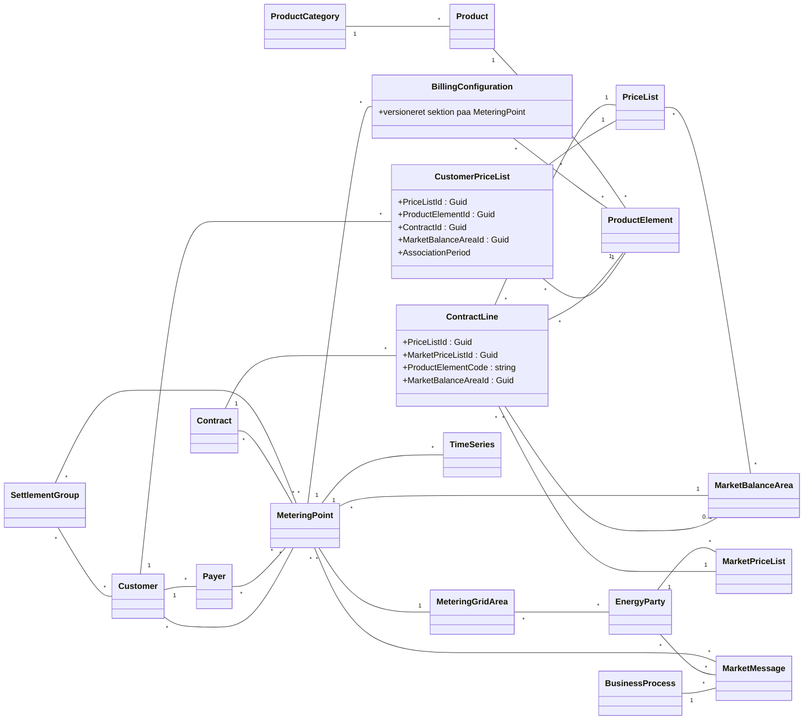

# Settl Data Object Model

To kilder:

- `settl-data-object-model.png` — RFP-skitsen (konceptuel, ikke autoritativ).
- **Dette dokument** — afstemt mod den faktiske API: OpenAPI-spec
  (`docs/settl-openapi/2026-06-15/Billing-Internal.json` + `Market-Internal.json`) og
  klient-koden (`src/DataMigration.SettlApi/Models` + `Clients`).

> Hvor RFP-skitsen og API'et er uenige, **vinder API'et**. De vigtigste afvigelser er
> noteret nederst under "Afvigelser fra RFP-skitsen".

## Diagram (API-afstemt)

## Bevis pr. relation (fra OpenAPI / klient-kode)

| Relation | Status | Bevis |
|---|---|---|
| Customer → Payer | ✅ | `PayerCreateDto.CustomerId`; `GET /api/v1/Payers/{payerId}` |
| Customer → MeteringPoint | ✅ | `GET /api/v2/customers/{customerId}/meteringPoints`; `CustomerMeteringPointDto.MeteringPointId` |
| Payer → MeteringPoint | ✅ | `GET /api/v1/Payers/{payerId}/MeteringPoints`; `PayerMeteringPointDto.MeteringPointId` |
| Customer → CustomerPriceList → PriceList/ProductElement | ✅ | `GET /api/v2/customers/{id}/pricelists`; `CustomerPriceListDto.{PriceListId,ProductElementId}` |
| CustomerPriceList → Contract | ⚠️ felt findes, **typisk tom-GUID** | `CustomerPriceListDto.ContractId` |
| CustomerPriceList → MarketBalanceArea | ⚠️ felt findes, **typisk tom-GUID** | `CustomerPriceListDto.MarketBalanceAreaId` |
| Contract → ContractLine | ✅ | `AddContractLineDto` |
| Contract → MeteringPoint | ✅ | `GET /api/v1/contracts/{contractId}/meteringPoints`; `ContractMeteringPointDto.MeteringPointId` |
| ContractLine → PriceList / MarketPriceList / ProductElement / MarketBalanceArea | ✅ | `AddContractLineDto.{PriceListId,MarketPriceListId,ProductElementCode,MarketBalanceAreaId}` |
| BillingConfiguration (på MeteringPoint) | ✅ | `BillingMeteringPointCurrentDto.BillingConfiguration` (versioneret) |
| BillingConfiguration → ProductElement (exemptions) | ✅ | `GET /api/v1/meteringPoints/{id}/exemptions`; `BillingExemptionDto.ProductElementId` |
| MeteringPoint → MarketBalanceArea / MeteringGridArea | ✅ | `MeteringPointGridDto.{MarketBalanceAreaId,MeteringGridAreaId}` |
| MeteringPoint → TimeSeries | ◐ separat API | ingen direkte schema-FK; konsumeres via time-series API |
| PriceList → MarketBalanceArea | ✅ | `GET /api/v1/priceLists/{priceListId}/marketBalanceAreas` |
| ProductCategory → Product → ProductElement | ✅ | `ProductCategoryFindResponse`, `ProductInfoDto`, `ProductElementInfoDto` |
| SettlementGroup → Customer / MeteringPoint | ✅ | `GET /api/v1/settlementGroups/{id}/customers` + `/meteringPoints` |
| Marked-side (EnergyParty/BusinessProcess/MarketMessage/MarketPriceList/MeteringGridArea) | ◐ partial | schemas i `Market-Internal.json`; løst koblet, mest read-only lookups |
| Invoice / InvoiceLine / Settlement | ✗ ikke i master-data-API | findes ikke som queryable entiteter i de to specs |

## Afvigelser fra RFP-skitsen (vigtigt)

1. **`BillingConfiguration` er ikke en central n-ær junction.** Den er en *versioneret
   sektion på MeteringPoint*. RFP-tegningens midter-junction der binder PriceList ↔ Contract
   ↔ MeteringPoint findes ikke sådan i API'et.
2. **Kontrakt↔pris lever på `ContractLine`**, ikke på `CustomerPriceList.ContractId`.
   En kontrakts prisstruktur er dens contract-lines (hver med `PriceListId` /
   `MarketPriceListId` / `ProductElementCode` / `MarketBalanceAreaId`).
3. **`CustomerPriceList.ContractId` og `.MarketBalanceAreaId` er typisk tom-GUID** — så
   per-kontrakt/per-MP-prislister via den association er ikke pålidelig. Vil man knytte
   pris til et MP, går vejen `Contract → ContractLine` + `Contract → MeteringPoint`.
4. **`InvoiceLine` har præcis ét `ProductElement` og ingen relation til `Product`.** Invoicing
   findes desuden ikke i master-data-API'et (kun i RFP-skitsen).
5. **`ProductCategory` har ingen direkte relation til `Settlement`.**

## Konsekvens for dashboard-featuren (MP-master)

- **MP → kontrakter**: solid og native (`Contract → MeteringPoint`).
- **MP → prislister**: kan **ikke** baseres på `CustomerPriceList.ContractId` (tom). Hvis
  per-MP-priser ønskes, skal det hentes via `Contract → ContractLine` for de kontrakter
  der er linket til MP'et. Ellers vises `CustomerPriceList` på kundeniveau (som nu).
