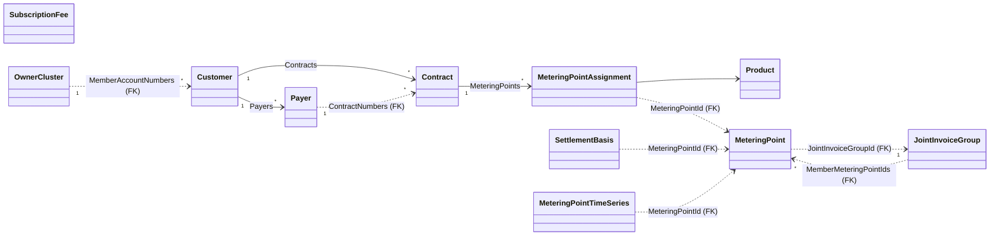
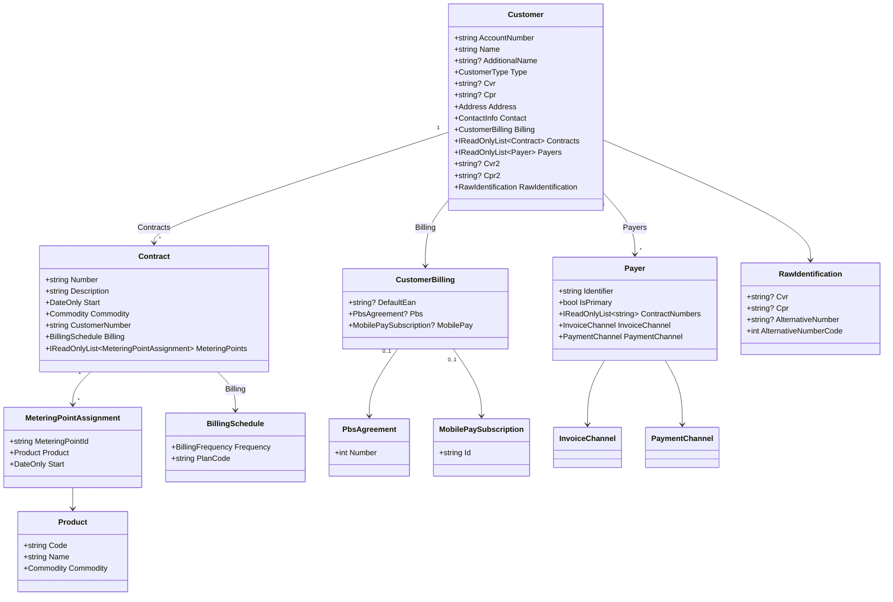
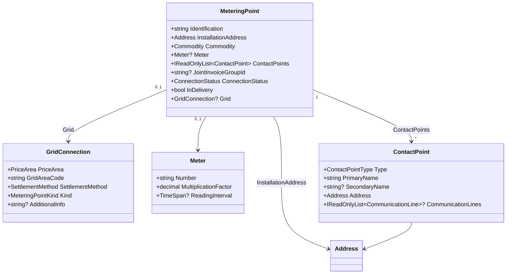
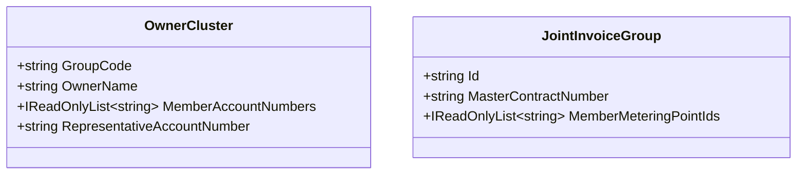
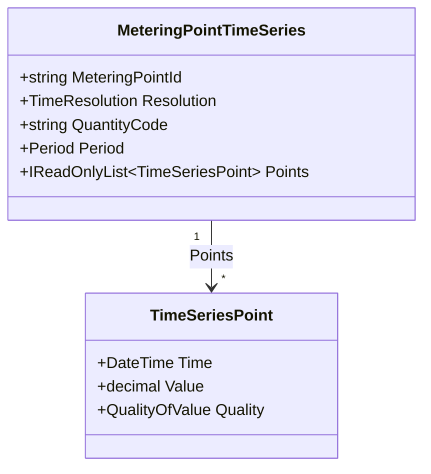
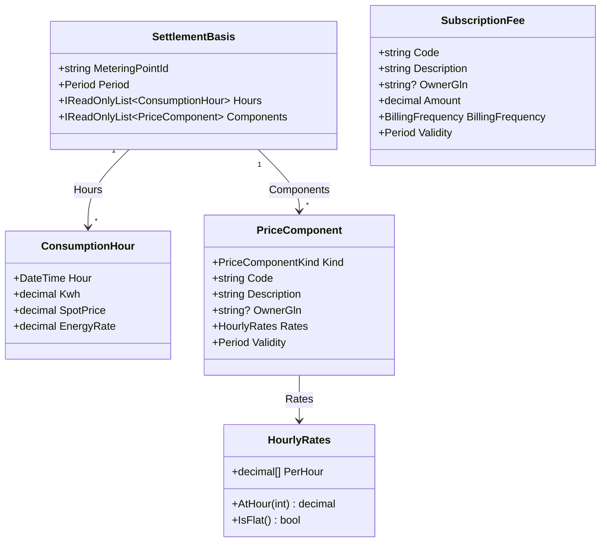
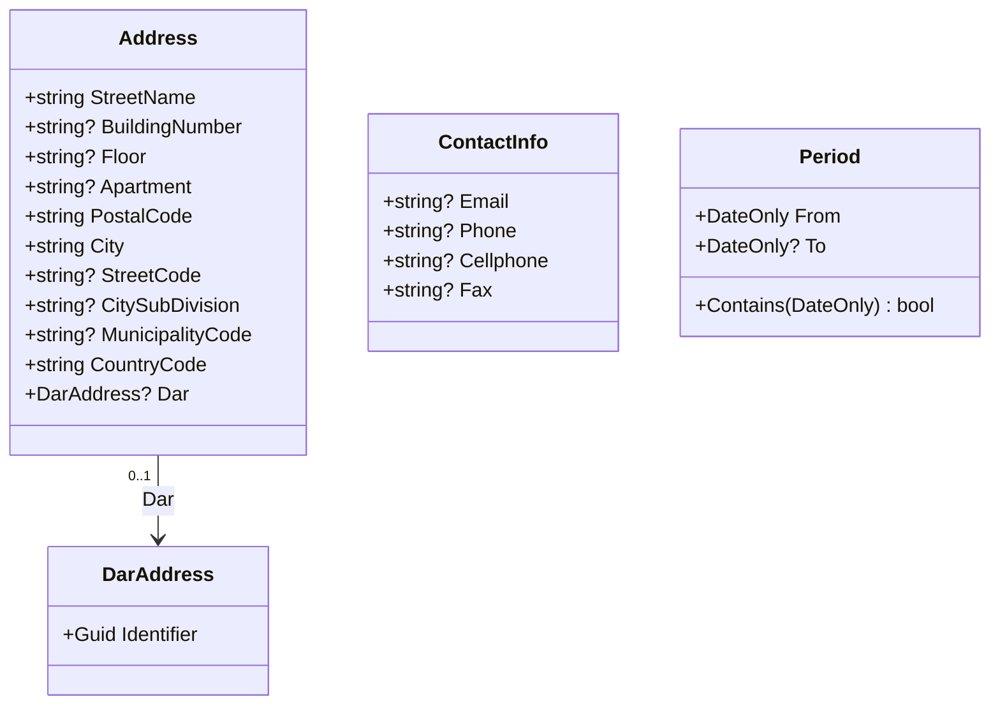
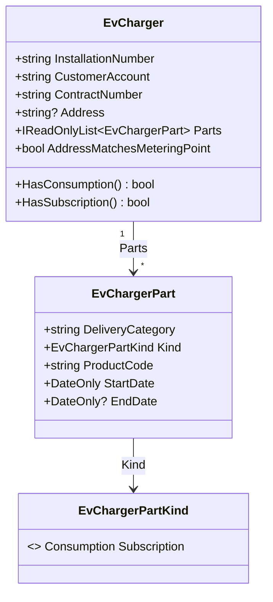
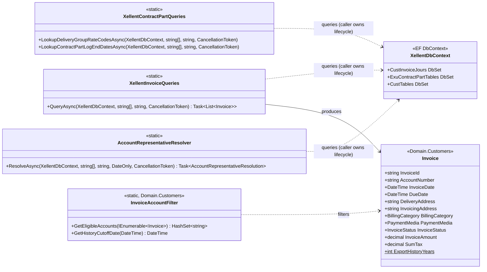

# Domain Model — `DataMigration.Domain` + `DataMigration.Domain.Engros`

Source-agnostic domain model for the Danish utility industry (electricity, water,
heat, EV charging). Used by `XellentDomainMapper` and future loaders. Supplier-
perspective: `Customer` is the aggregate root; `MeteringPoint` is a separate
aggregate with DataHub-aligned vocabulary; `SettlementBasis` is a third aggregate
that captures the engros price components driving billing for a (MP, period).

## Overview — aggregates and their relations

Three aggregates + lookup groups. Arrows = navigation/composition; dashed arrows =
FK relations on string-id.



**Aggregate boundaries:**
- **Customer** (root) owns `Contract`, `Payer`, `MeteringPointAssignment`,
  `CustomerBilling`. References `MeteringPoint` via id-string, does not own it.
- **MeteringPoint** (root) owns `GridConnection`, `Meter`, `ContactPoint`.
  Independent aggregate with DataHub-aligned vocabulary.
- **SettlementBasis** (root) owns `ConsumptionHour`, `PriceComponent`,
  `HourlyRates`. Per `(MeteringPointId, Period)`. `SubscriptionFee` is a second-
  order aggregate in the same namespace.
- **MeteringPointTimeSeries** (root) owns `TimeSeriesPoint`. Raw readings, not
  priced.
- **OwnerCluster** / **JointInvoiceGroup** are lookup tables, not aggregates —
  reference Customer/MeteringPoint via id-strings.

## Class diagram (full)

All types from `DataMigration.Domain` (Customers, MeteringPoints, Products, Common),
`DataMigration.Domain.Engros` (SettlementBasis graph) and
`DataMigration.Domain.TimeSeries` (MeteringPointTimeSeries) with fields and enum
values.

```mermaid
classDiagram
    direction LR

    %% ===== Customers =====
    class Customer {
        +string AccountNumber
        +string Name
        +string? AdditionalName
        +CustomerType Type
        +string? Cvr
        +string? Cpr
        +Address Address
        +ContactInfo Contact
        +CustomerBilling Billing
        +IReadOnlyList~Contract~ Contracts
        +IReadOnlyList~Payer~ Payers
        +string? Cvr2
        +string? Cpr2
        +RawIdentification RawIdentification
    }
    class Contract {
        +string Number
        +string Description
        +DateOnly Start
        +Commodity Commodity
        +string CustomerNumber
        +BillingSchedule Billing
        +IReadOnlyList~MeteringPointAssignment~ MeteringPoints
        +string? PaymentTerm
        +BuyerInvoicingReferences? BuyerInvoicing
    }
    class Payer {
        +string Identifier
        +bool IsPrimary
        +IReadOnlyList~string~ ContractNumbers
        +BuyerInvoicingReferences? BuyerInvoicing
        +InvoiceChannel InvoiceChannel
        +PaymentChannel PaymentChannel
    }
    class BuyerInvoicingReferences {
        +string? ElectronicNumber
        +string? OrderIdentifier
        +string? AgreementIdentifier
        +string? BuyerReferenceIdentifier
    }
    class MeteringPointAssignment {
        +string MeteringPointId
        +DateOnly Start
        +DateOnly EndDate
        +string AmrCode
    }
    class BillingSchedule {
        +BillingFrequency Frequency
        +string PlanCode
    }
    class CustomerBilling {
        +string? DefaultEan
        +PbsAgreement? Pbs
        +MobilePaySubscription? MobilePay
    }
    class RawIdentification {
        +string? Cvr
        +string? Cpr
        +string? AlternativeNumber
        +int AlternativeNumberCode
        +RawIdentification None$
    }
    class PbsAgreement { +int Number }
    class MobilePaySubscription {
        +string Id
        +string SourceContractNumber
        +MobilePayOrigin Origin
        +string SourceDeliveryCategory
        +int CandidateCount
    }
    class MobilePayOrigin { <<enum>> MainContract SubContract }
    class JointInvoiceGroup {
        +string Id
        +string MasterContractNumber
        +IReadOnlyList~string~ MemberMeteringPointIds
    }
    class OwnerCluster {
        +string GroupCode
        +string OwnerName
        +IReadOnlyList~string~ MemberAccountNumbers
        +string RepresentativeAccountNumber
    }

    class CustomerType { <<enum>> Person Company }
    class BillingFrequency { <<enum>> Monthly Quarterly SemiAnnually Annually Other }
    class PaymentChannel { <<enum>> Fik Bs EInvoiceFik MobilePay }
    class InvoiceChannel { <<enum>> Pdf Email OioUbl PbsBs MobilePay }
    class Commodity { <<enum>> Electricity Water Heat EvCharging }

    %% ===== MeteringPoints =====
    class MeteringPoint {
        +string Identification
        +Address InstallationAddress
        +Commodity Commodity
        +Meter? Meter
        +IReadOnlyList~ContactPoint~ ContactPoints
        +string? JointInvoiceGroupId
        +ConnectionStatus ConnectionStatus
        +bool InDelivery
        +GridConnection? Grid
        +DateOnly Start
        +double? EstimatedAnnualVolumeKwh
        +string? BillingName
        +BuyerInvoicingReferences? BuyerInvoicing
        +string? BillingExemptionTemplate
    }
    class GridConnection {
        +PriceArea PriceArea
        +string GridAreaCode
        +SettlementMethod SettlementMethod
        +MeteringPointKind Kind
        +string? AdditionalInfo
    }
    class Meter {
        +string Number
        +decimal MultiplicationFactor
        +TimeSpan? ReadingInterval
        +int Decimals
        +int DigitsOfPrecision
        +MeterReadingOccurrence ReadingOccurrence
        +string? MeteringPointSubType
    }
    class ContactPoint {
        +ContactPointType Type
        +string PrimaryName
        +string? SecondaryName
        +Address Address
        +IReadOnlyList~CommunicationLine~? CommunicationLines
    }
    class CommunicationLine {
        +string Type
        +string Value
    }

    class MeteringPointKind { <<enum>> Consumption Production NetProduction SupplyToGrid ConsumptionFromGrid OwnProduction ElectricalHeating NetConsumption OtherConsumption OtherProduction Effect WholesaleServicesInformation }
    class PriceArea { <<enum>> Dk1 Dk2 }
    class SettlementMethod { <<enum>> Flex Profiled NonProfiled }
    class ConnectionStatus { <<enum>> Connected Disconnected }
    class MeterReadingOccurrence { <<enum>> Hourly QuarterHourly }
    class ContactPointType { <<enum>> Technical Legal }

    %% ===== Products =====
    class Product {
        +string Code
        +string Name
        +Commodity Commodity
    }

    %% ===== Common =====
    class Address {
        +string StreetName
        +string? BuildingNumber
        +string? Floor
        +string? Apartment
        +string PostalCode
        +string City
        +string? StreetCode
        +string? CitySubDivision
        +string? MunicipalityCode
        +string CountryCode
    }
    class DarAddress { +Guid Identifier }
    class ContactInfo {
        +string? Email
        +string? Phone
        +string? Cellphone
        +string? Fax
    }
    class Period {
        +DateOnly From
        +DateOnly? To
    }

    %% ===== Relations =====
    Customer "1" --> "*" Contract : Contracts
    Customer "1" --> "*" Payer : Payers
    Customer --> Address
    Customer --> ContactInfo
    Customer --> CustomerBilling : Billing
    Customer --> RawIdentification
    Customer --> CustomerType

    Contract "1" --> "*" MeteringPointAssignment : MeteringPoints
    Contract --> BillingSchedule
    Contract --> Commodity

    Payer "1" ..> "*" Contract : ContractNumbers (FK)

    MeteringPointAssignment --> Product

    BillingSchedule --> BillingFrequency
    Payer --> InvoiceChannel
    Payer --> PaymentChannel
    CustomerBilling "0..1" --> PbsAgreement
    CustomerBilling "0..1" --> MobilePaySubscription
    MobilePaySubscription --> MobilePayOrigin

    MeteringPoint --> Address : InstallationAddress
    MeteringPoint --> Commodity
    MeteringPoint --> Meter
    MeteringPoint "1" --> "*" ContactPoint : ContactPoints
    MeteringPoint --> GridConnection
    MeteringPoint --> ConnectionStatus

    GridConnection --> PriceArea
    GridConnection --> SettlementMethod
    GridConnection --> MeteringPointKind

    Meter --> MeterReadingOccurrence

    ContactPoint --> ContactPointType
    ContactPoint --> Address
    ContactPoint "1" --> "*" CommunicationLine : CommunicationLines

    Product --> Commodity

    Address --> DarAddress

    Contract --> BuyerInvoicingReferences
    Payer --> BuyerInvoicingReferences
    MeteringPoint --> BuyerInvoicingReferences

    %% ===== Cross-aggregate FK-relationer =====
    MeteringPoint ..> JointInvoiceGroup : JointInvoiceGroupId (FK)
    JointInvoiceGroup "1" ..> "*" MeteringPoint : MemberMeteringPointIds (FK)
    OwnerCluster "1" ..> "*" Customer : MemberAccountNumbers (FK)
    MeteringPointAssignment ..> MeteringPoint : MeteringPointId (FK)
    Contract ..> Customer : CustomerNumber (FK)

    %% ===== Engros (SettlementBasis) =====
    class SettlementBasis {
        +string MeteringPointId
        +Period Period
        +IReadOnlyList~ConsumptionHour~ Hours
        +IReadOnlyList~PriceComponent~ Components
    }
    class ConsumptionHour {
        +DateTime Hour
        +decimal Kwh
        +decimal SpotPrice
        +decimal EnergyRate
    }
    class PriceComponent {
        +PriceComponentKind Kind
        +string Code
        +string Description
        +string? OwnerGln
        +Period Validity
    }
    class HourlyRates {
        +decimal[] PerHour
        +AtHour(int) decimal
        +IsFlat() bool
    }
    class SubscriptionFee {
        +string Code
        +string Description
        +string? OwnerGln
        +decimal Amount
        +BillingFrequency BillingFrequency
        +Period Validity
    }
    class PriceComponentKind { <<enum>> GridTariff StateTax ProductMargin }

    SettlementBasis ..> MeteringPoint : MeteringPointId (FK)
    SettlementBasis --> Period
    SettlementBasis "1" --> "*" ConsumptionHour : Hours
    SettlementBasis "1" --> "*" PriceComponent : Components
    PriceComponent --> HourlyRates : Rates
    PriceComponent --> PriceComponentKind
    PriceComponent --> Period : Validity
    SubscriptionFee --> BillingFrequency
    SubscriptionFee --> Period : Validity

    %% ===== TimeSeries =====
    class MeteringPointTimeSeries {
        +string MeteringPointId
        +TimeResolution Resolution
        +string QuantityCode
        +Period Period
        +IReadOnlyList~TimeSeriesPoint~ Points
    }
    class TimeSeriesPoint {
        +DateTime Time
        +decimal Value
        +QualityOfValue Quality
    }
    class TimeResolution { <<enum>> None Quarter Hour Month Day Year Minute }
    class QualityOfValue { <<enum>> MachineApprovedReading }

    MeteringPointTimeSeries ..> MeteringPoint : MeteringPointId (FK)
    MeteringPointTimeSeries --> TimeResolution
    MeteringPointTimeSeries --> Period
    MeteringPointTimeSeries "1" --> "*" TimeSeriesPoint : Points
    TimeSeriesPoint --> QualityOfValue
```



## Customer aggregate



`Customer.AccountNumber` is the representative key. Merged Xellent accounts (sharing
CVR + Fingerprint) collapse to one `Customer`. `Cvr` is 8 digits (Danish business
registry); `Cpr` is 10 digits (Danish person registry). `Cvr2`/`Cpr2` carry a second
authorized person (disponent 2) when the source has one; the name for that second
person lives in `AdditionalName`.

`RawIdentification` holds `Cvr`/`Cpr`/`AlternativeNumber`/`AlternativeNumberCode`
exactly as the source system held them, before normalisation collapsed an unusable
value to `null` on `Customer.Cvr`/`Cpr`. It lets a consumer tell "the field was
empty" apart from "the field held something that didn't validate" — needed by the
skipped-customer section of the create report. Defaults to `RawIdentification.None`.

`Customer.Contracts` is the customer's portfolio of supplier-customer agreements.
Each contract has its own `MeteringPointAssignment[]` referencing
`MeteringPoint.Identification` for the actual MP stamdata, and its own
`BillingSchedule` (`Frequency` + raw `PlanCode`) — different contracts on the
same customer can be billed on different rhythms.

`Customer.Payers` is the customer's billing parties — always at least one (the
primary), with additional payers fanned out per distinct contract-level EAN.
Each `Payer` carries its own `InvoiceChannel`/`PaymentChannel`, computed by
`PayerMapper` from the payer's own EAN and the customer's `CustomerBilling`
state (MobilePay beats PBS beats EAN beats email, falling back to PBS_BS/FIK).

`CustomerBilling` is the customer-level billing state the loader resolves from
Xellent: `DefaultEan` becomes the primary payer's electronic number (extra payers
are keyed by contract-level EANs that differ from it), `Pbs` is the active PBS
direct-debit agreement, `MobilePay` the active MobilePay subscription. Each is
non-null only when that channel is in use.

## MeteringPoint (flat, composition)



`MeteringPoint` is a flat record with no inheritance. The `Grid` field discriminates
between MP-types: present (non-null) for grid-connected DataHub-registered electricity
MPs; null for installation-based water, heat and EV-charging MPs. Use
`Commodity` for branching when discriminating between commodity types.

`JointInvoiceGroupId` is a foreign key to a `JointInvoiceGroup`; null for
stand-alone MPs.

Not shown above (present on the full record, omitted here for brevity): `Start`,
`EstimatedAnnualVolumeKwh`, `BillingName`, `BuyerInvoicing`, and
`BillingExemptionTemplate` — non-null when one of the MP's active contracts sits
on a billing-fee-exempt contract template (matched via
`MapperOptions.BillingExemptionTemplateSuffix`); see the full diagram above.

## Cross-customer / cross-MP relations



`OwnerCluster` wraps ≥2 representative customers sharing the same TG4
organisational grouping (synthetic owner above representatives).

`JointInvoiceGroup` collects metering points that are billed together on one
invoice. `Id` equals the master contract number; `MemberMeteringPointIds` lists
all MPs in the group (master's own MPs + member contracts' MPs).

## Time-series (measured values)



`MeteringPointTimeSeries` is raw metering-point values fetched 1:1 from the source
system — not aggregated, not priced. `MeteringPointId` is FK to
`MeteringPoint.Identification`. `Resolution` marks the interval size
(`Hour`, `Quarter`, …); `Time` on each point is the start of the interval.

`SettlementBasis` (Engros) conceptually references the same measurement basis,
but is a separate aggregate: it holds consumption hour-by-hour with spot price
and pricing components. `MeteringPointTimeSeries` is only the raw numbers — use
this package when you need plain metered data with no settlement overlay.

## Engros (settlement basis)



`SettlementBasis` (settlement basis) bundles hour-by-hour consumption +
spot reference and the list of active `PriceComponent`s for a (`MeteringPointId`,
`Period`). A consumer reconstructs hourly cost as
`Σ component.Rates.AtHour(hour) × hour.Kwh` over the components whose
`Validity` covers the hour. `MeteringPointId` is FK to `MeteringPoint.Identification`.

`PriceComponent.Kind` distinguishes three kinds:
- `GridTariff` — DSO grid tariff (typically time-of-use)
- `StateTax` — state taxes (electricity tax, PSO)
- `ProductMargin` — supplier margin on a specific product

**Energy is NOT included as a `PriceComponent`** — the per-hour price the consumer
paid for energy (spot + trading cost + supplier margin) sits on
`ConsumptionHour.EnergyRate`. That's because the energy price varies per
*concrete date-hour* (Monday 14:00 ≠ Tuesday 14:00 because the spot price
changes), while `HourlyRates` models *clock-hour-of-day* variation, not
date-hour. Hourly cost is computed as `Kwh × EnergyRate + Σ active PriceComponents × Kwh`.

The same `Code` can appear more than once in a single `SettlementBasis` if the
rate changed along the way — each entry has its own `Validity`.

`HourlyRates(decimal[24])` represents hour-varying rates. For components with a
flat rate the same value sits in all 24 fields; use `IsFlat()` to detect it.
Index 0 = hour 00–01, index 23 = hour 23–24.

`SubscriptionFee` is a subscription/fixed fee. **NOT included in `SettlementBasis`** —
the settlement basis is at per-kWh level. SubscriptionFee lives in the Engros
package so consumers wanting the full billing picture (basis + subscriptions)
find both in the same place. `BillingFrequency` here means *how often this
specific subscription is charged* — distinct from `Customer.Billing.Frequency`
(*how often the customer is invoiced overall*); it's the same enum.

## Common types



`Address` is DK-flavoured — `MunicipalityCode`, `StreetCode`, `CitySubDivision` and
`Dar` (Danmarks Adresseregister) are all DK-specific.

`Period(From, To?)` is a half-open interval — `From` inclusive, `To` exclusive.
`To = null` means "still in effect". Used by Engros types (`PriceComponent.Validity`,
`SubscriptionFee.Validity`, `SettlementBasis.Period`) where periodisation is central.
Customer/Contract/MeteringPoint don't use Period — they are snapshot-style with
only a `Start` date.

## Loader output (not domain)

`XellentDomainMapper.LoadAsync(accounts)` returns `XellentLoadResult` — a loader
plumbing type that lives in `DataMigration.Domain.Xellent`, NOT in
`DataMigration.Domain`. It bundles entities loaded for one call:

```csharp
record XellentLoadResult(
    IReadOnlyList<Customer> Customers,
    IReadOnlyList<MeteringPoint> MeteringPoints,
    IReadOnlyList<OwnerCluster> OwnerClusters,
    IReadOnlyList<JointInvoiceGroup> JointInvoiceGroups,
    DateOnly SnapshotDate,
    IReadOnlyDictionary<string, string?> MpOrderIdentifiers,
    IReadOnlyList<AccountGrouping> AccountGroupings,
    IReadOnlyDictionary<string, AccountFingerprint> FingerprintByRepresentative)
{
    IReadOnlyDictionary<string, IReadOnlyList<EvCharger>> EvChargersByMeteringPoint { get; init; }
    IReadOnlyDictionary<string, IReadOnlyList<EvCharger>> EvChargersByAccount { get; init; }
}
```

`MpOrderIdentifiers`, `AccountGroupings` and `FingerprintByRepresentative` are
representation-principle plumbing (see workspace `CLAUDE.md`), not domain
entities either. `EvChargersByMeteringPoint`/`EvChargersByAccount` are the two
outcomes of the EV-charger tie-break described below — both default to empty
and are populated only for electricity loads.

Other loaders (Bifrost, future) may return their own result-shape; consumers
that need cross-loader compatibility should code against domain entities, not
against `XellentLoadResult` specifically.

### EV chargers — tying an installation to its metering point



`EvCharger.Parts` are the parts in force at the extraction's reference date, ordered
by start date. `HasConsumption`/`HasSubscription` are convenience checks over
`Parts` for the two Xellent delivery categories (`Charge`, `Charge_Abo`).
`EvChargerPart.EndDate` is the raw contract-part end date (inclusive, or `null` for
Xellent's "no end" sentinel) — not a half-open `Period`, so no off-by-one is
introduced translating it.

A charger (`EvCharger`) sits on a contract of its own with no reference to the
electricity it charges from. The link is made from the electricity side: contract
parts carrying `V LadVariP`/`V LadVarUA` point, via agreement and delpoint, at an
E17 consumption metering point. The account is the only meeting point, so the
rule is per account:

- **One candidate metering point** → every charger on the account is tied to it
  (`EvChargersByMeteringPoint`). No postal-code check — the single candidate wins
  even when the postal codes differ.
- **Several candidates** → each installation is matched by postal code first:
  `EXU_INSTALLATION.ZIPCODEID` against the candidates' `EXU_DELPOINT.ZIPCODEID`.
  Exactly one candidate with the same postal code ties that installation. When
  several share it, the address is compared next — DAR id
  (`EXU_INSTALLATION.ADDRESSID` vs `EXU_DELPOINT.ADDRESSID`, only when both are
  real, non-zero ids; equal ties, different rules out), else the street part of
  `INSTADDRESSFORMATTED` (before the first comma, normalised) against the
  delpoint's street name (`EXU_STREET` through the street code, `ADDRESSSTREET`
  as fallback) plus `HOUSENUMSTART`/`HOUSELETTERSTART` — and exactly one address
  match ties it. Two installations on the same account can so land on two
  different metering points. No postal-code match, an address that does not
  single one out, or a blank installation postal code leaves the installation on
  the account (`EvChargersByAccount`) with a warning naming the candidates and
  both outcomes as counts ("matches 2, address matches 0/2") — never the address.
- **No candidates** → chargers stay on the account, no warning.

Every tied charger also carries `EvCharger.AddressMatchesMeteringPoint`: the same
address comparison against the metering point it was tied to, whatever settled the
tie. A single candidate still wins without a check, but the flag says whether the
installation is at that point's address; false when the sides cannot be compared,
and always false for a charger left on its account. A consumer can treat several
chargers on one metering point as one household's when every one of them carries
the flag (account 491704: two installations at the metering point's own address).

The electricity side reads the parts as the contract-part restore
(`MapperOptions.RestorePartsChangedFrom/Before`) sees them: a charger-product part
the batch end-dated or deleted still links the charger once restored, and the
ordinary date rule is re-run in memory afterwards. The charger side is not
restored — the batch touched El-ekstern only.

## Xellent query utilities (`DataMigration.Domain.Xellent`)

Static classes in `Domain.Xellent` that issue direct Xellent queries and return
domain types. They accept an `XellentDbContext` object directly — it's the
caller's responsibility to own its lifecycle and connection string.



### XellentInvoiceQueries

Queries `CUSTINVOICEJOUR` and returns `List<Invoice>` with Xellent integer codes cast to
domain enums (`BillingCategory`, `PaymentMedia`, `InvoiceStatus`).

```csharp
List<Invoice> invoices = await XellentInvoiceQueries.QueryAsync(
    context, accountNumbers, MigrationConstants.DataAreaId, ct);
```

Large account arrays are automatically split into chunks of 2,000 to stay within SQL
Server's parameter limit.

`Invoice` (from `DataMigration.Domain.Customers`) contains:

| Field | Type | Note |
|---|---|---|
| `InvoiceId` | `string` | Trimmed Xellent INVOICEID |
| `AccountNumber` | `string` | Trimmed INVOICEACCOUNT |
| `InvoiceDate` | `DateTime` | |
| `DueDate` | `DateTime` | |
| `DeliveryAddress` | `string` | Trimmed; empty string if null |
| `InvoicingAddress` | `string` | Trimmed; empty string if null |
| `BillingCategory` | `BillingCategory` | Enum; `.ToLabel()` → "Slutafregning", "Aconto", … |
| `PaymentMedia` | `PaymentMedia` | Enum; `.ToLabel()` → "PBS", "FIK", "OIOXML", "MobilePay" |
| `InvoiceStatus` | `InvoiceStatus` | Enum; `.ToLabel()` → "Faktureret", "Krediteret" |
| `InvoiceAmount` | `decimal` | INVOICEAMOUNTMST |
| `SumTax` | `decimal` | SUMTAX |
| `ExportHistoryYears` | `const int = 5` | Used by `InvoiceAccountFilter.GetHistoryCutoffDate` |

The method returns all matching rows unfiltered. `InvoiceAccountFilter.GetEligibleAccounts`
(in `DataMigration.Domain.Customers`) filters to accounts whose latest invoice is `Final` or
`PureFinal` (final settlement).

### XellentContractPartQueries

Queries `EXU_CONTRACTPARTTABLE` and `EXU_CONTRACTPARTLOG`. Used for rate-code lookup
and the delete log for contract parts. See `XellentContractPartQueries.cs` for the API.

### AccountRepresentativeResolver

Resolves representative grouping over a full set of Xellent account numbers. See
`AccountRepresentativeResolver.cs` and the workspace `CLAUDE.md` (Representation principle) for
detail.

## Enums

| Enum | Namespace | Values |
|---|---|---|
| `CustomerType` | Customers | `Person`, `Company` |
| `Commodity` | Customers | `Electricity`, `Water`, `Heat`, `EvCharging` |
| `BillingCategory` | Customers | `None`, `Settlement`, `Aconto`, `SettlementAndAconto`, `Final`, `PureFinal` — `.ToLabel()` → dansk label |
| `PaymentMedia` | Customers | `None`, `Pbs`, `Fik`, `OioXml`, `MobilePay` — `.ToLabel()` → dansk label |
| `InvoiceStatus` | Customers | `None`, `Invoiced`, `Credited` — `.ToLabel()` → dansk label |
| `InvoiceChannel` | Customers | `Pdf`, `Email`, `OioUbl`, `PbsBs`, `MobilePay` |
| `PaymentChannel` | Customers | `Fik`, `Bs`, `EInvoiceFik`, `MobilePay` |
| `BillingFrequency` | Customers | `Monthly`, `Quarterly`, `SemiAnnually`, `Annually`, `Other` |
| `MobilePayOrigin` | Customers | `MainContract`, `SubContract` — where on the contract tree `MobilePaySubscription` was found |
| `EvChargerPartKind` | Customers | `Consumption`, `Subscription` |
| `PriceArea` | MeteringPoints | `Dk1`, `Dk2` |
| `SettlementMethod` | MeteringPoints | `Flex`, `Profiled`, `NonProfiled` |
| `MeteringPointKind` | MeteringPoints | `Consumption`, `Production`, `NetProduction`, `SupplyToGrid`, `ConsumptionFromGrid`, `OwnProduction`, `ElectricalHeating`, `NetConsumption`, `OtherConsumption`, `OtherProduction`, `Effect`, `WholesaleServicesInformation` |
| `ConnectionStatus` | MeteringPoints | `Connected`, `Disconnected` |
| `MeterReadingOccurrence` | MeteringPoints | `Hourly`, `QuarterHourly` |
| `ContactPointType` | MeteringPoints | `Technical`, `Legal` |
| `PriceComponentKind` | Engros | `GridTariff`, `StateTax`, `ProductMargin` |
| `TimeResolution` | TimeSeries | `None`, `Quarter`, `Hour`, `Month`, `Day`, `Year`, `Minute` |
| `QualityOfValue` | TimeSeries | `MachineApprovedReading` |

## Design principles

- **Snapshot for master data; period for wholesale** — Customer/Contract/MeteringPoint are snapshot-style (only a `Start` date, no `End`); they represent the source system's current and future-dated state. Engros types (`SettlementBasis`, `PriceComponent`, `SubscriptionFee`) are period-based with `Period(From, To?)` because rates change over time and the settlement basis covers history.
- **Read-only records** — no behavior methods, no builders. Loaders own invariants; consumers see data.
- **Source-agnostic, DK-target** — no Xellent/Exu references in `DataMigration.Domain`. Danish utility-industry concepts (CVR/CPR, DAR, FIK, BS, OIOUBL, PBS, MobilePay, DK1/DK2) are kept as primary citizens since DK is the exclusive target.
- **Customer as aggregate root** — supplier-perspective: a customer *has* contracts, contracts *have* MP-assignments. Matches how the industry structures data commercially.
- **MeteringPoint as separate aggregate** — DataHub-aligned: MPs have independent lifecycle and can move between customers; referenced from `MeteringPointAssignment` by id.
- **Composition over inheritance for MPs** — `Grid` field discriminates grid-connected from installation-based MPs; no subtypes.
- **Loader output stays in loader package** — `XellentLoadResult` lives in `Domain.Xellent`, not in `Domain.Customers`. Domain holds entities; loader holds plumbing.
- **DataHub-aligned electricity concepts** — `MeteringPointKind`, `SettlementMethod`, `GridAreaCode` follow Energinet's DataHub model.
- **`Customer.AccountNumber` = representative key** — merged Xellent accounts collapse to one Customer; `OwnerCluster` lives one level above and groups multiple representatives sharing organisational ties (TG4).
- **Two-layer validation** — shape-errors in loader (logged via `IWarningCollector`); policy-checks via `ICustomerValidator` (in `Domain.Xellent.Validation/`, run by consumer).
- **Naming convention for stable identifiers** — fields with the `Code` suffix (`PlanCode`, `Product.Code`, `PriceComponent.Code`, `GridAreaCode`, `MunicipalityCode`, `StreetCode`, `CountryCode`, `OwnerCluster.GroupCode`) are stable string identifiers from a source system or industry standard, retained for traceability and special-case handling. Entity primary keys keep their domain-natural names (`Customer.AccountNumber`, `MeteringPoint.Identification`, `Contract.Number`, `JointInvoiceGroup.Id`, `MobilePaySubscription.Id`).
