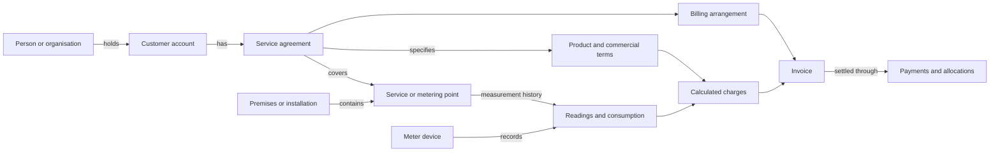

# Utility business model

This document describes a conceptual business model for utility suppliers and
related service companies. It provides a shared vocabulary for understanding
customers, supply, measurement, commercial terms, and billing across electricity,
water, heat, charging, and other recurring services.

It builds on the repository's existing [domain model](domain-model.md) and
[design discussion](domain-model-discussion.md). The business concepts below are
intended to be usable across systems. They are a working model, rather than an
industry standard or a claim that every concept already has a corresponding C#
class or database table. The final section maps them to the current implementation.

Use this document to understand what a record means in the business. Use the
[Xellent investigation guide](xellent-model-guide.md) for joins and EF examples,
and the [schema reference](xellent-schema-reference.md) for mapped columns.

## 1. The overall picture

A utility supplies a commodity or service to a customer under an agreement.
Delivery takes place at a service location and may be measured at one or more
measurement points. Commercial terms determine how delivered quantities and
recurring services become charges. Billing arrangements determine when those
charges are invoiced, who receives the invoice, and how payment is collected.

Arrows show business relationships, not database foreign keys or mandatory
one-to-one relationships. Unmetered services can produce charges directly from
their commercial terms. The model uses a service agreement as the agreement for
a particular service point; a wider framework agreement can group these agreements.
Systems that use the word *contract* for a framework need an explicit distinction
between the framework and its individual supply relationships.

## 2. Parties, accounts, and roles

| Concept | Business meaning |
|---|---|
| Party | A person or organisation participating in the relationship. |
| Customer | The party holding the commercial relationship with the supplier. |
| Customer account | The supplier's administrative record of that relationship. A party can have several accounts. |
| Payer | The party or billing arrangement responsible for paying specified charges. Its identity and scope must be established explicitly. |
| Invoice recipient | The person, organisation, or electronic destination receiving an invoice. |
| Occupant or user | The party using the supplied service at the premises. |
| Owner | The party owning premises, equipment, or an organisation, depending on the relationship being described. |
| Contact | A person or communication destination used for a stated purpose, such as access, operations, or billing. |

One party can fill several roles. An organisation can be the customer while a
central finance function receives invoices and a local contact provides access
to the meter. A shared address, payment method, or organisational group alone
does not establish that two customer accounts represent the same legal party.

Customer address, service address, correspondence address, and invoice address
have separate purposes. Keep the role of each address when interpreting data.

### Commodity and market role

Keep **what is supplied** separate from **the role a market participant performs**.
Electricity is a commodity. Electricity supplier is a market role, held by a
participant in relation to the relevant service and period. A business model should
retain both dimensions rather than infer the role from the commodity alone.

In Xellent, `El-ekstern` identifies the **DataHub electricity supplier role**
(*el-leverandør*), as clarified by the domain owner. Its commodity is electricity;
`El-ekstern` is not a separate utility or commodity. Although the source stores
this value in `DELIVERYCATEGORY`, that field's values do not form a uniform list
of utilities. Preserve the raw classification and its business meaning separately.

## 3. Agreements, products, and supply

A **service agreement** describes the customer's entitlement and obligations for
a particular service: the service point, commodity, effective dates, applicable
products, and commercial terms. A customer can hold several agreements, including
agreements for different utilities at the same premises.

A **product** describes what is sold. A **product assignment** records which
product applies to an agreement during a period. A change of product or price can
therefore occur while the customer, service point, and meter stay the same.
Several components can apply together, such as a consumption product and a fixed
subscription. Their overlap may be intentional.

A **framework or umbrella agreement** can organise commercial or billing
relationships for several underlying service agreements. Its membership must be
distinguished from the direct service-point relationship of an individual agreement.

For investigations, answer these questions separately:

- Which customer held the agreement during the period?
- Which service point did the agreement cover?
- Which products and price versions applied during that period?
- Which billing arrangement applied to the resulting charges?

Changing customer at a premises usually changes the commercial relationship.
Replacing a meter changes the measurement equipment. Neither event alone establishes
that the service point itself has acquired a new identity.

## 4. Premises, service points, and equipment

| Concept | Business meaning |
|---|---|
| Premises or site | The place where services are supplied; it can contain several installations and services. |
| Installation | The technical arrangement through which a service is delivered or measured. Its precise scope depends on the utility. |
| Service point | The identified delivery location or service boundary used by an agreement. |
| Metering point | An identified measurement boundary. It may represent a physical meter location or a calculated quantity. |
| Meter | A device used to record quantities. Its serial number identifies equipment. |
| Register or channel | A particular quantity recorded by a meter, such as energy, volume, or an import/export direction. |
| Network connection | The technical relationship to a distribution network, where relevant. |

A service point and metering point can coincide. More complex services can use
several measurements to establish one billable quantity. Document that relationship
explicitly instead of assuming a universal one-meter-per-service structure.

Meter installation and removal establish the periods during which a device
contributes readings to a point. A meter replacement can preserve the point and
agreement while introducing a different register baseline or multiplication factor.

Connection status, active supply, active agreement, and available readings describe
different aspects of the service. One status alone is insufficient to infer the others.

### Business events and what they change

An event affects a particular relationship. Establish the effective date and
scope before treating it as a change to the entire customer relationship.

| Event | What to examine | What the event alone does not establish |
|---|---|---|
| Customer moves out | End of that customer's service agreement and the quantities belonging to its period. | Removal of the service point, replacement of the meter, or termination of the customer's other agreements. |
| Another customer moves in | Start of the new customer's agreement at the service point. | Transfer of all historical consumption to the new customer. |
| Meter is replaced | Removal and installation readings, dates, units, and device factors. | A new customer or a new commercial agreement. |
| Product changes | The old and new product assignments and their effective periods. | A new service point or meter. |
| Payment arrangement is cancelled | The collection authorisation and how outstanding or future invoices will be handled. | Termination of supply or of the service agreement; those require separate evidence. |
| An invoice is issued after move-out | The service period and charges on that invoice. | An incorrect invoice merely because its issue date is later than move-out. |

This table describes how to interpret the model. It does not define an automatic
workflow for ending service, cancelling collection, or producing final bills.

## 5. Readings, quantities, and time

A **reading** is an observation at a time. An **interval quantity** describes a
quantity over a period. A cumulative register reading needs interpretation of the
register, unit, factor, resets, and replacement events before it can establish
consumption between readings.

An **estimate** is a quantity inferred for a purpose, such as expected annual
consumption or missing-period calculation. Preserve the distinction between
measured values, calculated quantities, and estimates, together with available
quality and provenance information.

Every measurement or calculation needs a quantity type and unit. The general model
allows energy, volume, power, temperature, counts, and other service-specific
quantities. An electricity-oriented property name ending in `Kwh` is insufficient
evidence that every underlying utility value uses that unit.

The relevant times are also separate:

- **Business validity:** when an agreement, product, price, or device assignment applies.
- **Measurement time:** when an observation was made or which interval it covers.
- **Recording time:** when the system received or changed a record.
- **Billing time:** when charges were calculated, invoiced, or became due.

Interpret a historical question using the relationships valid at that time.
Record the interval convention, time zone, and resolution where they matter;
source systems can differ on inclusive end dates and open-ended periods.

## 6. Prices, charges, invoices, and payments

The conceptual billing sequence is:

**Applicable agreement and product → billable quantity → applicable prices →
calculated charges → invoice → payment allocation.**

Some charges are fixed, and therefore require no measured quantity. A price can
vary by validity period, time of use, quantity band, capacity, or another
explicitly defined condition. Each charge should retain enough context to explain
its quantity, unit, rate, period, and origin.

| Concept | Question it answers |
|---|---|
| Price or tariff | What rate applies under which conditions? |
| Fixed fee or subscription | What amount is charged for availability or recurring service? |
| Charge | What amount was calculated for a particular service and period? |
| Billing schedule | When are charges collected into invoices? |
| Invoice | What amounts were formally billed, to whom, and when are they due? |
| Invoice delivery channel | How does the recipient receive the invoice? |
| Payment terms | When and under what terms is payment required? |
| Payment method or mandate | How is money collected, and what authorisation supports collection? |
| Payment and allocation | What money was received and which outstanding amounts does it settle? |

Invoice frequency, measurement frequency, and subscription charging frequency
can differ. Electronic invoicing identifies a delivery destination; a payment
mandate authorises a collection method. Neither establishes that an invoice has
been paid. Payment allocation and outstanding balances require their own evidence.

Corrections should preserve the relationship between the original quantity or
charge and the adjustment. A current recalculation can use different source
versions from those used by an earlier invoice.

The model can explain which information a bill depends on. Calculating the exact
amount also requires the applicable commercial rules and source values: rates,
quantities, fixed charges, treatment of partial periods, taxes, advances, and
adjustments as relevant to that product. Those rules are not all established by
this document. Likewise, the party paying or receiving an invoice alone does not
establish liability under an ownership or tenancy arrangement.

## 7. Grouping relationships

Groupings answer different business questions:

| Group | Purpose |
|---|---|
| Organisational group | Present related customers together, potentially across separate legal entities. |
| Site or property group | Find services and installations associated with the same premises. |
| Framework agreement | Organise related service agreements under common terms. |
| Joint invoice group | Combine eligible charges or service points into shared invoicing. |
| Payer's agreement group | Identify the agreements handled by a particular billing arrangement. |
| Technical hierarchy | Describe parent, child, aggregate, or component measurements. |

Membership in one group does not establish membership in another. In particular,
joint billing of several points does not increase the number of points directly
covered by an individual service agreement. Group membership may also change over time.

## 8. Utility-specific extensions

The common concepts can be specialised without forcing every utility to carry
electricity-specific fields. The following are illustrative modelling dimensions;
actual products determine which are needed.

| Service | Examples of additional concepts |
|---|---|
| Electricity | Import/export direction, network area, settlement method, interval energy, time-dependent prices. |
| Water | Volume registers, meter replacement history, fixed and consumption charges. |
| Heat | Energy and volume measurements, capacity or fixed charges, technical operating measurements. |
| EV charging | Charging installation, sessions or aggregate consumption, equipment and service subscriptions. |
| Other recurring services | Service subscriptions, usage events, service capacity, and units appropriate to the product. |

Utility coverage is open-ended. Source delivery categories remain in scope even
when the current application has no specialised domain type for them. Classify
each code by its meaning: it may describe a commodity, market role, or service
component. For example, `El-ekstern` belongs to the electricity supplier role.

### Charging subscription and consumption service

For charging, distinguish three questions: does the customer hold a consumption
service, does the customer hold a subscription, and was any consumption recorded
during the period? A subscription can be represented without a consumption-service
part. A consumption service can also exist during a period with no recorded use.
The presence of one component does not establish the presence of the other.

The current [charger model](../src/DataMigration.Domain/Customers/EvCharger.cs)
represents consumption and subscription parts independently. Whether a particular
combination is offered commercially, and what charge applies, depends on the
customer's actual agreement and product terms.

## 9. How the current repositories represent this model

This section describes implementation choices. They should be retained when
interpreting the current data, without making them requirements for every utility system.

| Business concept | Current representation and limitation |
|---|---|
| Customer and account | [`Customer`](../src/DataMigration.Domain/Customers/Customer.cs) combines customer identity, account identifier, contact information, contracts, and billing defaults. A separate general-purpose `Party` model is not provided. Xellent accounts originate in `CUSTTABLE`. |
| Service agreement | [`Contract`](../src/DataMigration.Domain/Customers/Contract.cs) describes a customer's agreement for one commodity. Xellent stores headers in `EXU_CONTRACTTABLE` and product/period parts in `EXU_CONTRACTPARTTABLE`. |
| Product assignment | [`MeteringPointAssignment`](../src/DataMigration.Domain/Customers/MeteringPointAssignment.cs) combines a point reference, product, and dates. Multiple assignments can describe the same point. |
| Product | [`Product`](../src/DataMigration.Domain/Products/Product.cs) provides code, name, and commodity. The current Xellent contract mapper copies the product code into `Name`; that value is not a separately resolved product description. Detailed prices are separate. |
| Market role | `El-ekstern` expresses the DataHub electricity supplier role in Xellent's `DELIVERYCATEGORY`. The current domain maps that scope to `Commodity.Electricity` and has no separate general-purpose market-role type. |
| Service and metering point | [`MeteringPoint`](../src/DataMigration.Domain/MeteringPoints/MeteringPoint.cs) is the shared abstraction. Xellent data is reached through installation or agreement/delpoint paths, depending on the contract part. Premises and service points are not separate general-purpose domain classes. |
| Equipment and connection | [`Meter`](../src/DataMigration.Domain/MeteringPoints/Meter.cs) describes a device snapshot; [`GridConnection`](../src/DataMigration.Domain/MeteringPoints/GridConnection.cs) supplies electricity-specific attributes. Full device history requires the relevant source records. |
| Payer and invoice recipient | [`Payer`](../src/DataMigration.Domain/Customers/Payer.cs) expresses billing groupings and channels. [`PayerMapper`](../src/DataMigration.Domain.Xellent/Internal/PayerMapper.cs) derives a default group and additional groups from distinct contract electronic-invoice destinations. Each supplied contract is assigned to one group; a default group can be empty. This grouping alone does not establish distinct legal payers. |
| Billing timing and collection | [`BillingSchedule`](../src/DataMigration.Domain/Customers/BillingSchedule.cs) belongs to the contract. [`CustomerBilling`](../src/DataMigration.Domain/Customers/CustomerBilling.cs) holds customer defaults and collection agreements; payer channels are derived separately. |
| Organisational and billing groups | [`OwnerCluster`](../src/DataMigration.Domain/Customers/OwnerCluster.cs) groups related customers; [`JointInvoiceGroup`](../src/DataMigration.Domain/Customers/JointInvoiceGroup.cs) groups points for shared invoicing. These are different relationships. |
| Measured time series | [`MeteringPointTimeSeries`](../src/DataMigration.Domain.TimeSeries/MeteringPointTimeSeries.cs) describes quantities and intervals independently of pricing. Installation readings also exist in CustomerSupport's Xellent mappings. |
| Pricing and calculation basis | [`SettlementBasis`](../src/DataMigration.Domain.Engros/SettlementBasis.cs) and [`PriceComponent`](../src/DataMigration.Domain.Engros/PriceComponent.cs) express an electricity-oriented per-kWh basis. [`SubscriptionFee`](../src/DataMigration.Domain.Engros/SubscriptionFee.cs) is separate. These types do not yet provide a general charge engine for every utility. |
| Invoice and receivables | [`Invoice`](../src/DataMigration.Domain/Customers/Invoice.cs) exposes invoice summary information. The broader concepts of charge lineage, payments, allocations, and balances require additional models or source records. |

### Xellent rules that must survive the business abstraction

- **One point-bearing Xellent contract directly relates to one distinct metering
  point or delpoint.** Several product/period parts can describe that same point.
  This is the business rule supplied by the domain owner; the EF model does not
  enforce it as a database constraint.
- Umbrella contracts can have no direct point. Joint invoicing and technical child
  points are separate relationships. A blank header delivery category is insufficient
  evidence that there is no direct point; follow the contract parts.
- A point can appear under different contracts over time. The current loader's
  date selection depends on commodity and options: electricity parts may start
  in the future, while water, heat, and EV charging parts must have started by
  the reference date. `IncludeEndedCutoff` can include ended contracts and parts.
  This selected snapshot is insufficient by itself for a complete historical
  account. See [loader date scope](xellent-field-semantics.md#loader-date-scope).
- An electronic invoice EAN identifies a billing destination. The national
  metering point identification and local installation/delpoint numbers identify
  other things. Preserve identifier type and source scope, including AX data area
  and the company/category fields required by a particular join.
- Current [`Commodity`](../src/DataMigration.Domain/Customers/Commodity.cs) values
  cover electricity, water, heat, and EV charging. The technical reference also
  covers mapped data outside those four values.
- Domain [`Period`](../src/DataMigration.Domain/Common/Period.cs) uses an inclusive
  start and exclusive end. Other source and domain date fields have different
  conventions; use the [field semantics reference](xellent-field-semantics.md)
  before interpreting boundaries or sentinel dates.

For an investigation, first name the business concept and the relevant period.
Then establish how the source represents it: a stored entity, a relationship,
a historical event, or a grouping derived by application code. This keeps the
business interpretation traceable to the underlying records.

## 10. Business evidence in everyday work

The [questions derived from repository usages](repository-business-questions.md)
show how the concepts above are used in customer service, consumption history,
delivery reports, and invoice-document handling.

### Finding records and assessing their quality

A customer-service enquiry can begin with a name, phone number, email, invoice
reference, or address. Each is evidence for finding candidate records. Record
which role matched: the agreement holder, invoice recipient, additional person,
postal address, supplied premises, or point contact. Shared contact details and
organisational grouping do not establish a single legal party or payer.

Assess data quality separately. A value can be present, correctly formatted,
consistent with other records, or verified against an authoritative source;
these are different claims. A ten-character identifier is not proof of identity,
and complete address fields are not proof that the address exists.

The consuming operation decides what a failed check means: report a warning,
record an error, exclude a customer, replace a value under a configured policy,
or stop. Keep that decision and its scope attached to the rule. In particular,
a policy for one market role must not become a general utility rule.

The [CustomerSupport enquiry review](customer-support-investigation-review.md)
checks whether the model supplies the correct retrieval routes. The separate
[DataMigration validation review](datamigration-validation-review.md) checks the
decisions made from the retrieved and mapped data.

### Establishing who was supplied on a date

Check both the customer's agreement and the applicable service/product assignment
on the requested date. An agreement can remain open after a particular assignment
ends. A screen's “active” label may use a simpler rule than a dated supply enquiry.
If several agreements appear to cover the same point and date, preserve that
conflict while investigating. A report choosing one row does not prove the others
were invalid or resolve responsibility on its own.

### Understanding consumption shown to a colleague

A displayed consumption value can be calculated from several readings, including
readings around a meter replacement. An annual estimate can be extrapolated from
a daily rate. Display labels such as “start of delivery” can also be derived from
reading characteristics. Keep the original readings and recorded events available
to explain how the display was produced.

For a customer who held service during separate periods, consider each period
separately. The time between the earliest start and latest end can include gaps
or another customer's occupancy. A chart covering that whole span does not by
itself establish that every quantity belongs to the selected customer.

The frequency of recorded values can change during the life of a point. Preserve
the relevant company and measurement periods when joining history. An hourly value
does not become four measured quarter-hour values merely because a configuration
says the point should be read more frequently.

### Understanding invoices, balances, and documents

Distinguish the issued invoice record, its billed lines, its PDF copy, and the
summary displayed in an application. A missing PDF or an invoice absent from a
filtered screen does not establish that no invoice was issued. Service icons on
a summary can be derived from related agreements; inspect invoice lines to establish
what was actually billed.

A customer account balance summarises transactions within a stated scope. The
amount overdue requires due dates and outstanding-amount evidence; whether one
invoice is settled requires allocation evidence. A sum of transactions alone does
not establish either. Currency also forms part of an amount's meaning.

A customer record can contain a note with no attached file. Document and note
views can group or filter records for display, so visible item counts need not
equal the number of underlying records. Establish what a view includes before
using its absence or totals as business evidence.
