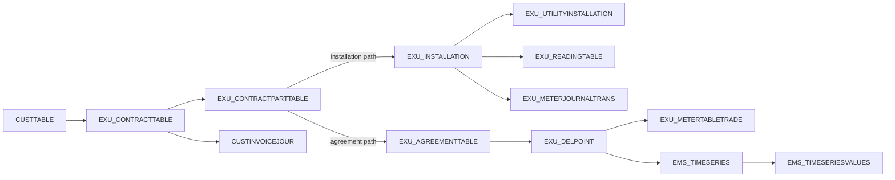

# Xellent data model for investigation

The companion [utility business model](utility-business-model.md) explains the
business concepts behind the records, from customers and service agreements to
metering, pricing, invoicing, and payments.

This guide covers the Xellent tables mapped by **both** `XellentDbContext` in this
repository and `XellentDatabaseModelContext` in CustomerSupport. It includes all
delivery categories represented by those models. Start with the [53-table column
reference](xellent-schema-reference.md) when an exact SQL column name or EF property
is needed. The [source-agnostic domain model](domain-model.md) describes the objects
produced from Xellent data; those objects are not SQL tables.
The [field semantics reference](xellent-field-semantics.md) adds code meanings,
date conventions, reading units, price versions, and differences between the two
EF models, with links to the implementations and tests supporting each detail.

For practical enquiries, use the [CustomerSupport retrieval review](customer-support-investigation-review.md):
names, contact details, invoice references and different address roles mapped to
the records needed to answer the question. The separate
[DataMigration validation review](datamigration-validation-review.md) explains
which data checks lead to warnings, errors, exclusions or normalisation.
The [development exercises](development-query-exercises.md) turn ten business
requests into scoped EF queries and record which examples compiled.

This is a **code-derived model**. The entity files define mapped columns and EF
keys; LINQ queries and relationship configuration show how the applications connect
tables. The code does not establish that every table or column in the SQL Server
database is mapped, nor prove that EF keys are database constraints. No live SQL
Server metadata or data was queried to produce this guide.

## Reading the model



The arrows summarize application joins, not SQL Server foreign keys. The
time-series header is reached by the delpoint's metering point identifier and
delivery category, not by a declared EF navigation property.

**Contract cardinality:** A point-bearing Xellent contract relates to one
distinct metering point or delpoint. It can have several contract-part rows for
products and periods associated with that same point. Multiple rows after a
contract-to-part join therefore do not mean multiple distinct points. A
customer can hold several contracts, one for each point, and a point can be
named by different contracts over time. A contract with no directly linked
point is also possible. This is the expected business cardinality supplied by
the domain owner; the C# mappings do not enforce it as a database constraint.
When an investigation returns two distinct points for one contract, check the
company/category join fields and then treat the result as a data exception to
examine. Technical child points reached through delpoint relationships and
inherited payment coverage are separate relationships; they do not imply another
direct contract-to-point link. See the product-part description in DataMigration's
`MeteringPointAccountResolver` and the measured subset in
[Xellent findings](xellent-datamodel.md).

`DATAAREAID` identifies the AX data area and participates in most joins. Many
installation, agreement, delpoint, meter, and period joins also require
`COMPANYID` and `DELIVERYCATEGORY`. Retain the fields used by the source query
when following a relationship; matching a number alone can combine records from
different companies or categories. An EF key in the column reference describes
entity tracking in that context, not necessarily the complete business identifier.

`DELIVERYCATEGORY` is a source classification, not a uniform commodity list.
In particular, `El-ekstern` means the **DataHub electricity supplier role**
(*el-leverandør*), as clarified by the domain owner; the commodity is electricity.
Keep this market role distinct from the commodity when interpreting category
filters or building a broader business model.

`EXU_CONTRACTPARTTABLE.INSTAGREENUM` has two documented meanings in the code:

| Path | Join from contract part | Used for |
|---|---|---|
| Installation | `INSTAGREENUM = EXU_INSTALLATION.INSTNUM` with `DATAAREAID` | Water, heat, charge, and other installation based parts |
| Agreement and delpoint | `INSTAGREENUM = EXU_AGREEMENTTABLE.AGREEMENTNUM`, then `AGREEMENTNUM = EXU_DELPOINT.ATTACHMENTNUM`, retaining `DATAAREAID` and `COMPANYID` | Electricity and other delpoint based investigations |

The same contract can have multiple parts and delivery categories while still
relating to one distinct point. Select the appropriate branch per **part**, not
solely from the contract header. A blank header category does not establish that
the contract has no direct point: `ContractMapper` explicitly handles blank
headers with water parts. Establish the link by following the parts. See
[`ContractMapper`](../src/DataMigration.Domain.Xellent/Internal/ContractMapper.cs),
[`MeteringPointMapper`](../src/DataMigration.Domain.Xellent/Internal/MeteringPointMapper.cs),
and the existing [Xellent findings](xellent-datamodel.md).

| Field or group | Meaning in the mapped model |
|---|---|
| `DATAAREAID` | AX data area; a required scope for most lookups and joins. |
| `COMPANYID`, `DELIVERYCATEGORY` | Company and delivery category within a data area; part of many installation agreement, delpoint, meter, and period identities. |
| `CUSTTABLE.ACCOUNTNUM`, `EXU_CONTRACTTABLE.CUSTACCOUNT` | Customer account and the contract's account reference. |
| `EXU_CONTRACTTABLE.CONTRACTNUM`, `EXU_CONTRACTPARTTABLE.CONTRACTNUM` | Contract header identifier and its part reference. |
| `EXU_CONTRACTPARTTABLE.INSTAGREENUM` | Installation number or agreement number, depending on the part's join path. |
| `EXU_INSTALLATION.INSTNUM`, `EXU_UTILITYINSTALLATION.INSTNUM` | Installation identifier; the utility row adds a category. |
| `EXU_AGREEMENTTABLE.AGREEMENTNUM`, `EXU_DELPOINT.ATTACHMENTNUM` | Agreement and delpoint link on the delpoint path. |
| `EXU_DELPOINT.NUM`, `EXU_DELPOINT.METERINGPOINT` | Local delpoint number and national metering point identifier, respectively. |
| `EXU_METERJOURNALTRANS.METERNUM`, `EXU_READINGTABLE.METERNUM` | Meter identifier on installation journal events and readings. |
| `EXU_READINGTABLE.READINGDATE`, `METERREADING`, `CONSUMPTION` | Reading timestamp, register value, and recorded consumption. `EXU_READINGTABLE` is mapped by CustomerSupport. |
| `EMS_TIMESERIES.RECID`, `EMS_TIMESERIESVALUES.TIMESERIESREFRECID` | Series header and value link. Value rows also carry time, value, quality, and version end. |
| `RECID` | AX record identifier where present; it is not a replacement for company/category filters in a business join. |

Dates often use `1900-01-01` to mean no end date; some data uses `2154-12-31`
as a future sentinel. Determine the meaning for the specific column before
applying a current-date filter. Period tables contain `STARTDATE` and `ENDDATE`
and can have multiple rows for one business object. For data investigation,
inspect the history first, then add a date predicate. The `EXU_CONTRACTPARTLOG`
table records deletions **and changes to dates**, with the part state before the
change. A missing live part does not prove that it never existed, and a log row
does not by itself prove deletion. Sources:
[log queries](../src/DataMigration.Domain.Xellent/XellentContractPartQueries.cs),
[constants](../src/DataMigration.Core/MigrationConstants.cs)
and [Xellent findings](xellent-datamodel.md).

## Table families

Every table named below has a column listing in the
[schema reference](xellent-schema-reference.md). The descriptions summarize the
role visible in C#; they do not assert that the mapped fields exhaust the table.

| Family | Tables and role |
|---|---|
| Customer and contact | `CUSTTABLE` customer account; `CONTACTPERSON` contact identifier; `DIRPARTYADDRESSRELATIONSHIP` party to address relationship; `DIRPARTYADDRESSRELATIONSHI1066` relationship to address record; `ADDRESS` address; `ADDRESSZIPCODE` postal lookup; `EXU_STREET` street lookup; `DIRECOMMUNICATIONADDRESS` communication value; `DIRPARTYECOMMUNICATIONRELA2608` party to communication value. |
| Contract and installation | `EXU_CONTRACTTABLE` contract header; `EXU_CONTRACTPARTTABLE` product/category part; `EXU_CONTRACTPARTLOG` part change log; `EXU_AGREEMENTTABLE` installation agreement for the delpoint path; `EXU_INSTALLATION` physical installation; `EXU_UTILITYINSTALLATION` installation/category attributes; `EXU_GROUPTABLE` group name; `EXU_BILLINGPLAN` billing plan; `EXU_CONTRACTTEMPLATE` template. |
| Delpoint and meter | `EXU_DELPOINT` delpoint and national metering point identifier; `EXU_DELPOINT2DELPOINTRELA25505` primary/secondary delpoint relationship; `EXU_DELPOINTCONTACTINFOTABLE` dated contact details; `EGS_METERPOINTTYPECODEPERIOD` dated type; `EXU_METERPOINTSTATUSPERIOD` dated status; `EXU_BILLINGMETHODPERIOD` dated billing method; `EXU_TIMEREADINGSPERIOD` dated time resolution; `EXU_METERTABLETRADE` dated meter on delpoint; `EXU_METERJOURNALTRANS` installation meter journal; `EXU_READINGTABLE` installation readings; `EXU_READINGTABLEEXT` delpoint reading extension and expected annual consumption. |
| Time series and prices | `EMS_TIMESERIES` series header; `EMS_TIMESERIESVALUES` series values; `EXU_FLEXBHISTORYTABLE` billing history header; `EXU_FLEXBHISTORYLINE` hourly values and prices; `EXU_DELPOINTPRICEELEMENTR25046` delpoint charge assignment; `EXU_PRICEELEMENTCHECK` metering point charge check; `EXU_PRICEELEMENTCHECKDATA` dated charge type; `EXU_PRICEELEMENTTABLE` charge definition; `EXU_PRICEELEMENTRATES` hourly charge rates; `EXU_PRODUCTEXTENDTABLE` product type and validity; `EXU_RATETABLE` product rates; `INVENTTABLE` item attributes. |
| Invoices and documents | `CUSTINVOICEJOUR` posted invoice header; `CUSTINVOICETRANS` posted invoice lines; `CUSTINVOICETABLE` free text invoice header; `CUSTINVOICELINE` free text invoice lines; `CUSTINVOICESALESLINK` invoice to sales link; `CUSTINVOICEBACKORDERLINE` backorder line; `CUSTTRANS` customer transaction; `DOCUREF` document reference; `DOCUVALUE` document value; `DOCUTYPE` document type; `VDOSALESJOURNALENTRY` sales journal entry; `VDOSALESJOURNALPRODUCT` sales journal product. |

The 13 tables marked only **CS** in the column reference require
`XellentDatabaseModelContext`; they are not `DbSet`s on `XellentDbContext`.
CustomerSupport owns that independent EF model. DataMigration and
TimeSeriesMigration consume the XellentDomain package and add query behavior.

## Relationships grounded in C#

The relationship numbers in the source of
[`XellentDatabaseModelContext`](../../NewSettlement.CustomerSupport/src/CustomerSupport.XellentDatabaseModel/XellentDatabaseModelContext.cs)
cover 31 EF relationships. The rows below also cite XellentDomain query code
where it clarifies the path. `1:N` describes the modeled direction; whether
every parent has children must be checked in the data.

| From → to | Join or relation | C# source |
|---|---|---|
| Customer → contract | `CUSTTABLE.(DATAAREAID, ACCOUNTNUM) = EXU_CONTRACTTABLE.(DATAAREAID, CUSTACCOUNT)` | CustomerSupport context #1; `MeteringPointMapper` |
| Contract → contract part | `(DATAAREAID, CONTRACTNUM)` | CustomerSupport context #2; `ContractMapper` |
| Contract → parent contract | `(DATAAREAID, REFERENCETOMAINCONTRACT) = (DATAAREAID, CONTRACTNUM)` when the reference is populated | CustomerSupport context #11 |
| Contract part → installation | `(DATAAREAID, INSTAGREENUM) = (DATAAREAID, INSTNUM)` | CustomerSupport context #13; `ContractMapper` |
| Installation → utility installation | `(DATAAREAID, INSTNUM)`, and inspect `DELIVERYCATEGORY` on the utility row | CustomerSupport `CustomerSearchService` |
| Installation → meter journal | `(DATAAREAID, INSTNUM) = (DATAAREAID, INSTALLATIONNUM)` plus `DELIVERYCATEGORY` | `MeteringPointMapper` |
| Installation → reading | `(DATAAREAID, INSTNUM)`; retain `DELIVERYCATEGORY` when selecting readings | CustomerSupport context #30 |
| Contract part → agreement | `(DATAAREAID, COMPANYID, INSTAGREENUM) = (DATAAREAID, COMPANYID, AGREEMENTNUM)` | CustomerSupport context #3; `ContractMapper` |
| Agreement → delpoint | `(DATAAREAID, COMPANYID, AGREEMENTNUM) = (DATAAREAID, COMPANYID, ATTACHMENTNUM)`; retain category | CustomerSupport context #4; `ContractMapper` |
| Delpoint → meter trade and periods | `(DATAAREAID, DELIVERYCATEGORY, COMPANYID, ATTACHMENTNUM, NUM)` matches `(DATAAREAID, DELIVERYCATEGORY, COMPANYID, AGREEMENTNUM/ATTACHMENTNUM, DELPOINTNUM)` | CustomerSupport context #5, #6, #22; `MeteringPointMapper` |
| Delpoint → primary/secondary delpoint relation | Full five-part delpoint identifier, once for each end | CustomerSupport context #20–21 |
| Delpoint → price element assignment | Full five-part delpoint identifier | CustomerSupport context #18 |
| Price element assignment → charge definition | `(DATAAREAID, DELIVERYCATEGORY, PARTYCHARGETYPEID, VALIDINMARKETFROM)` | CustomerSupport context #19; see field semantics for the narrower XellentDomain mapping |
| Time series header → values | `(DATAAREAID, RECID) = (DATAAREAID, TIMESERIESREFRECID)` | CustomerSupport context #7; `TimeSeriesMapper` |
| Billing history header → hourly line | `(DATAAREAID, HISTKEYNUMBER)` | `SettlementBasisMapper` |
| Price check → check data → charge definition → rates | `(DATAAREAID, RECID) = (DATAAREAID, PRICEELEMENTCHECKREFRECID)`, then `(DATAAREAID, PARTYCHARGETYPEID)` | `SettlementBasisMapper` |
| Contract part → product extension → item → rate | `(DATAAREAID, PRODUCTNUM)` then `PRODUCTTYPE = ITEMID`; rate selection uses `RATETYPE`, `DELIVERYCATEGORY`, and dates | `SettlementBasisMapper` |
| Customer → party address → address link → address | `(DATAAREAID, PARTYID)`, then relationship `RECID`, then `ADDRESSRECID = ADDRESS.RECID` | CustomerSupport context #8–10; `MeteringPointMapper` |
| Customer/contract → invoice journal | Invoice `INVOICEACCOUNT = ACCOUNTNUM` and `EXU_CONTRACTNUM = CONTRACTNUM`, each with `DATAAREAID` | CustomerSupport context #14–15; `InvoiceService` |
| Invoice journal → posted lines/sales links/backorder lines | `(DATAAREAID, INVOICEID)` | CustomerSupport context #24, #28–29 |
| Free text invoice → customer/contract/lines | Customer account and contract number with `DATAAREAID`; lines use `(DATAAREAID, PARENTRECID) = (DATAAREAID, RECID)` | CustomerSupport context #25–27 |
| Customer → customer transaction | `(DATAAREAID, ACCOUNTNUM)` | CustomerSupport context #31 |
| Document reference → document value | `VALUERECID = RECID` in the CustomerSupport mapping | CustomerSupport context #12 |

`EXU_METERPOINTSTATUSPERIOD`, `EXU_TIMEREADINGSPERIOD`, and
`EXU_BILLINGMETHODPERIOD` carry the same delpoint identity columns and a
`STARTDATE` in their mapped EF keys. `EXU_DELPOINTCONTACTINFOTABLE` instead
uses `METERINGPOINT` with company, category, contact type, and date. Verify
period overlap and active-row rules for the question being investigated.

The joins above come from application code. In particular, a relationship
configured in CustomerSupport may be convenient for `Include`, while the
XellentDomain context may require an explicit LINQ join. The
[`XellentDbContext`](../src/DataMigration.XellentData/XellentDbContext.cs)
mainly configures keys and does not declare this navigation graph.

For additional query examples already used by applications, see
[`TimeSeriesExtractionService`](../../NewSettlement.TimeSeriesMigration/src/TimeSeries.Migration/Services/TimeSeriesExtractionService.cs)
for delpoint periods and time series,
[`ReportMeterHistoryRunner`](../../NewSettlement.DataMigration/src/DataMigration.OpsCli.Library/Runners/ReportMeterHistoryRunner.cs)
for meter history, and
[`CustomerSearchService`](../../NewSettlement.CustomerSupport/src/CustomerSupport.Api/Services/CustomerSearchService.cs)
for installation category attributes. These are evidence for relationships;
their application filters answer narrower questions than the general model.

## EF investigation examples

These examples assume an existing `XellentDbContext context` using read-only database credentials, a
`dataAreaId`, and a `CancellationToken cancellationToken`. They select identifiers,
dates, codes, and counts, and limit the result size. Add the relevant category,
company, and date filters for the specific investigation. They do not require
SQL strings or entity navigation properties.
Use `Microsoft.EntityFrameworkCore` for the async and tracking extensions.
`AsNoTracking()` disables EF change tracking; database permissions provide the
read-only boundary. `supportContext` below is CustomerSupport's
`XellentDatabaseModelContext`. Supply `companyId`, `deliveryCategory`, identifiers,
and dates explicitly. `Take` makes these diagnostic samples; a truncated sample
cannot establish full counts or uniqueness.

### Follow an account through contract parts and installations

```csharp
var installationParts = await (
    from customer in context.CustTables.AsNoTracking()
    join contract in context.ExuContractTables.AsNoTracking()
        on new { customer.Dataareaid, customer.Accountnum }
        equals new { contract.Dataareaid, Accountnum = contract.Custaccount }
    join part in context.ExuContractPartTables.AsNoTracking()
        on new { contract.Dataareaid, contract.Contractnum }
        equals new { part.Dataareaid, part.Contractnum }
    join installation in context.ExuInstallations.AsNoTracking()
        on new { part.Dataareaid, Instnum = part.Instagreenum }
        equals new { installation.Dataareaid, installation.Instnum }
    where customer.Dataareaid == dataAreaId
       && customer.Accountnum == accountNumber
       && part.Deliverycategory == deliveryCategory
       && part.Companyid == companyId
    orderby contract.Contractnum, part.Startdate, part.Recid
    select new {
        customer.Accountnum, contract.Contractnum, part.Deliverycategory,
        part.Companyid, part.Productnum, part.Startdate, part.Enddate,
        installation.Instnum, installation.Recid
    }
).Take(200).ToListAsync(cancellationToken);
```

This includes ended parts for the selected installation-based category. Choose
the path after inspecting the contract parts; a number matching `INSTNUM` alone
does not prove that the part is installation-based. To inspect
the installation's category attributes, join `ExuUtilityInstallations` on
`Dataareaid`, `Instnum`, and `Deliverycategory`.

### Inspect meter events for an installation

```csharp
var meterEvents = await context.ExuMeterJournalTrans.AsNoTracking()
    .Where(row => row.Dataareaid == dataAreaId
        && row.Deliverycategory == deliveryCategory
        && row.Companyid == companyId
        && row.Installationnum == installationNumber)
    .OrderBy(row => row.Transdate)
    .ThenBy(row => row.Recid)
    .Select(row => new {
        row.Installationnum, row.Companyid, row.Meternum, row.Transdate,
        row.Journaltype, row.Posted, row.Recid
    })
    .Take(200)
    .ToListAsync(cancellationToken);
```

`EXU_READINGTABLE` is mapped in **CustomerSupport's** context. For actual
reading history, use `XellentDatabaseModelContext` and its
`ExuReadingTables` set, filtered by `Dataareaid`, `Instnum`, and
`Deliverycategory`, ordered by `Readingdate`. That model also exposes
`Meterreading`, `Consumption`, `Counternum`, `Readingstatus`, and
`Quantitycodevalue`.

```csharp
var readings = await supportContext.ExuReadingTables.AsNoTracking()
    .Where(row => row.Dataareaid == dataAreaId
        && row.Instnum == installationNumber
        && row.Deliverycategory == deliveryCategory
        && row.Companyid == companyId)
    .OrderBy(row => row.Readingdate)
    .ThenBy(row => row.Recid)
    .Select(row => new {
        row.Instnum, row.Deliverycategory, row.Companyid, row.Meternum, row.Counternum,
        row.Readingdate, row.Meterreading, row.Consumption,
        row.Readingstatus, row.Reasontoreading, row.Quantitycodevalue
    })
    .Take(500)
    .ToListAsync(cancellationToken);
```

### Follow a contract part through agreement to delpoint

```csharp
var delpoints = await (
    from part in context.ExuContractPartTables.AsNoTracking()
    join agreement in context.ExuAgreementTables.AsNoTracking()
        on new { part.Dataareaid, part.Companyid, Agreementnum = part.Instagreenum }
        equals new { agreement.Dataareaid, agreement.Companyid, agreement.Agreementnum }
    join delpoint in context.ExuDelpoints.AsNoTracking()
        on new { agreement.Dataareaid, agreement.Companyid,
                 Attachmentnum = agreement.Agreementnum }
        equals new { delpoint.Dataareaid, delpoint.Companyid,
                     delpoint.Attachmentnum }
    where part.Dataareaid == dataAreaId
       && part.Contractnum == contractNumber
       && part.Companyid == companyId
       && part.Deliverycategory == deliveryCategory
       && delpoint.Deliverycategory == deliveryCategory
    orderby part.Startdate, part.Recid, delpoint.Recid
    select new {
        part.Contractnum, part.Instagreenum, part.Deliverycategory, part.Companyid,
        delpoint.Attachmentnum, delpoint.Num, delpoint.Meteringpoint
    }
).Take(200).ToListAsync(cancellationToken);
```

The national metering point identifier is `EXU_DELPOINT.METERINGPOINT`.
`EXU_DELPOINT.NUM` is the delpoint number used within the composite join;
`EXU_CONTRACTTABLE.EINVOICEEANNUM` is a billing identifier. These are
different identifiers.

### Inspect a time series header and its values

```csharp
var currentVersion = new DateTime(2154, 12, 31, 23, 59, 59);
var points = await (
    from series in context.EmsTimeseries.AsNoTracking()
    join value in context.EmsTimeseriesValues.AsNoTracking()
        on new { series.Dataareaid, Timeseriesrefrecid = series.Recid }
        equals new { value.Dataareaid, value.Timeseriesrefrecid }
    where series.Dataareaid == dataAreaId
       && series.Meteringpoint == meteringPointIdentification
       && series.Deliverycategory == deliveryCategory
       && series.Companyid == companyId
       && value.Versiontoexcl == currentVersion
       && value.Timeofvalue >= fromUtc
       && value.Timeofvalue < toUtc
    orderby value.Timeofvalue, series.Recid, value.Recid
    select new {
        SeriesRecid = series.Recid, series.Companyid,
        series.Quantitycodevalue, series.Timeresolution,
        ValueRecid = value.Recid,
        value.Timeofvalue, value.Value, value.Qualityofvalue,
        value.Versiontoexcl
    }
).Take(500).ToListAsync(cancellationToken);
```

This uses the current-version sentinel from
[`TimeSeriesMapper`](../src/DataMigration.Domain.Xellent/Internal/TimeSeriesMapper.cs).
Remove that predicate only when explicitly examining version history. A company
can still have multiple series headers/resolutions for a point: retain the header
identifier in results and select the required header or resolution before
aggregating. `TIMEOFVALUE` is treated as UTC in TimeSeriesMigration. Convert local
calendar-day boundaries to UTC before supplying `fromUtc` and `toUtc`.
The example uses an exclusive upper bound. The short `TimeSeriesMapper` currently
uses an inclusive upper bound; see the [boundary difference](xellent-field-semantics.md#time-series-header-selection)
when comparing its output with this query.

## Keeping the reference current

Run `python tools/generate-xellent-schema-reference.py` after changing either
entity model. Review the guide when joins or interpretations change in
`DataMigration.Domain.Xellent` or CustomerSupport's EF context. A future
read-only comparison with SQL Server catalog metadata can identify tables and
columns absent from both code models; until then, coverage claims remain
explicitly limited to mapped C# entities.
